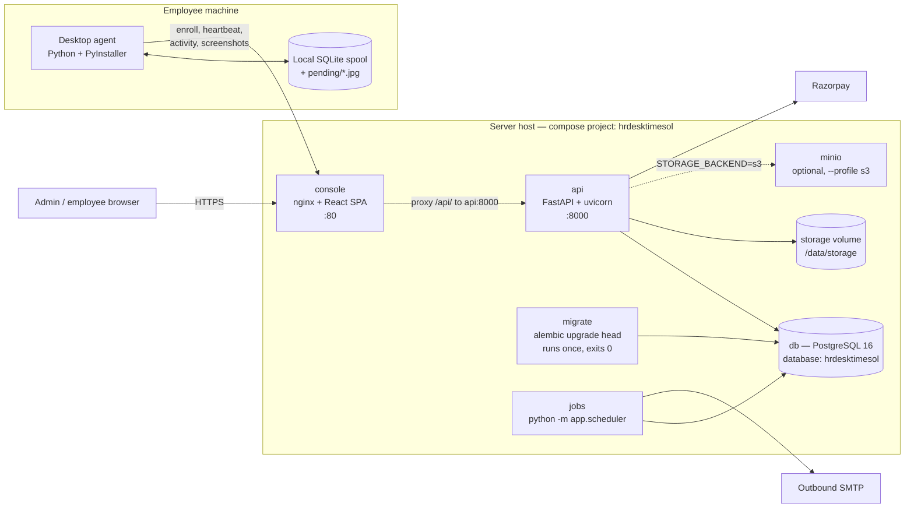
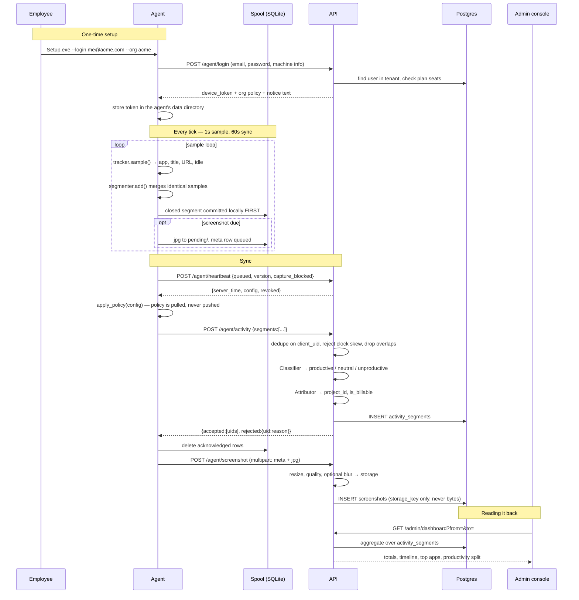
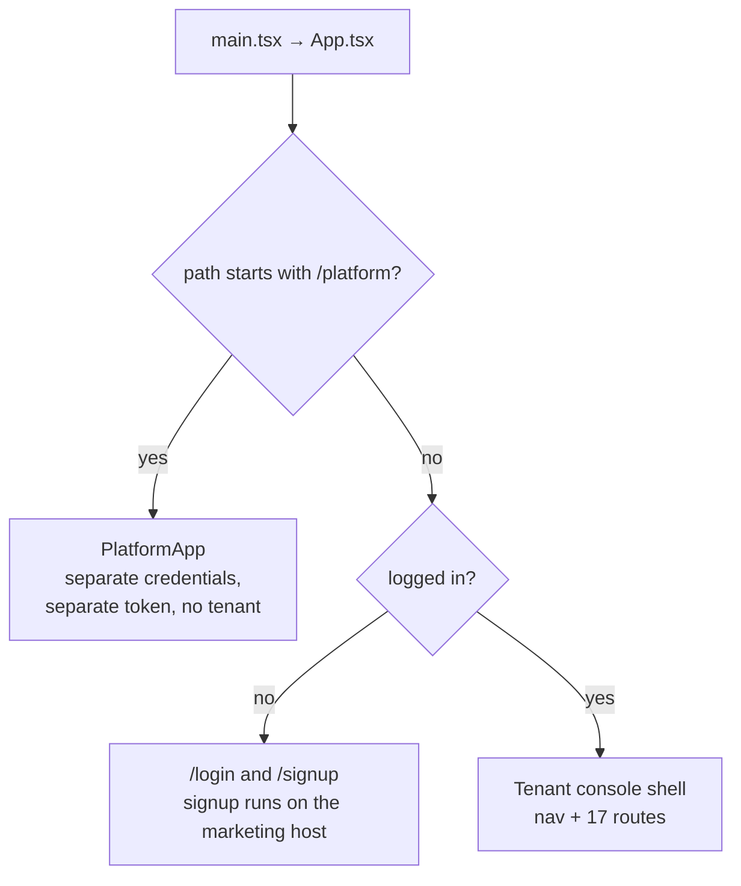
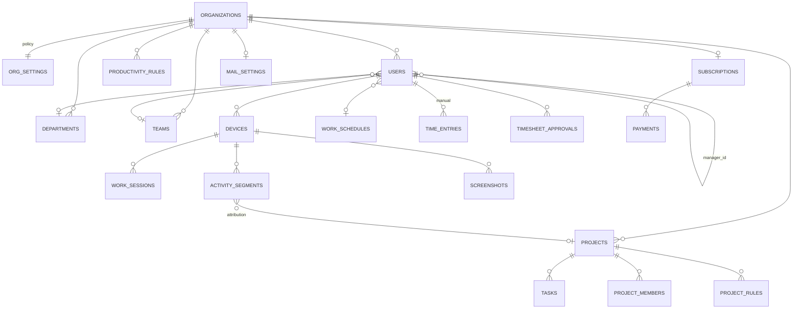

# hrdesktimesol — System Architecture

A multi-tenant HRMS. A desktop agent watches what an employee's machine is
doing, a multi-tenant API ingests it, and a web console turns it into timesheets,
productivity reports and screenshots — alongside attendance and geofencing,
leave, onboarding, offboarding, asset custody and an HR helpdesk.

Those nine modules are one product, not a tracking tool with an HRMS bolted on.
Activity & Timesheets is simply the module that was built first, and it is a peer
of the other eight rather than their foundation — which is why the employee's
home screen reads across all nine and the report catalogue covers all nine.

This document is the map of the whole thing — every moving part, and every wire
between them. It is written so someone who has never opened this repository can
work out where a given behaviour lives and what it talks to.

> **Naming.** The *project*, the *database*, the *Docker images* and the *compose
> project* are all `hrdesktimesol`. The *product name shown to users* is still
> "MyDeskTime" — in the console wordmark, in outbound email, in the agent's setup
> prompts and in the API title. That split is deliberate; see
> [Naming and isolation](#15-naming-and-isolation-from-mydesktime).

---

## Table of contents

1. [The shape of the system](#1-the-shape-of-the-system)
2. [Repository layout](#2-repository-layout)
3. [The data path, end to end](#3-the-data-path-end-to-end)
4. [The desktop agent](#4-the-desktop-agent)
5. [The API server](#5-the-api-server)
6. [The web console](#6-the-web-console)
7. [The jobs runner](#7-the-jobs-runner)
8. [Multi-tenancy, identity and authorisation](#8-multi-tenancy-identity-and-authorisation)
9. [The data model](#9-the-data-model)
10. [Screenshot storage](#10-screenshot-storage)
11. [Plans, signup and billing](#11-plans-signup-and-billing)
12. [Email and alerting](#12-email-and-alerting)
13. [The reporting engine](#13-the-reporting-engine)
14. [Configuration reference](#14-configuration-reference)
15. [Naming and isolation from MyDeskTime](#15-naming-and-isolation-from-mydesktime)
16. [Running it](#16-running-it)
17. [Build and release artifacts](#17-build-and-release-artifacts)
18. [Tests](#18-tests)
19. [Open items](#19-open-items)

---

## 1. The shape of the system

Five processes and one installed program. Nothing else.



| Process | Image / build | What it is | Talks to |
|---|---|---|---|
| `db` | `postgres:16-alpine` | The only durable state that matters | — |
| `migrate` | `hrdesktimesol-api` | One-shot `alembic upgrade head`, then **Exited (0)** — that is success, not failure | `db` |
| `api` | `./server` → `hrdesktimesol-api` | FastAPI. Every read and write goes through it | `db`, storage volume, S3, Razorpay |
| `console` | `./admin` → `hrdesktimesol-console` | nginx serving the built SPA, proxying `/api/` to `api:8000` | `api` |
| `jobs` | `hrdesktimesol-api` | `python -m app.scheduler` — alerts every 15 min, retention hourly | `db`, SMTP |
| `minio` | `minio/minio` | Local S3 for testing object storage. Only starts with `--profile s3` | — |
| **agent** | `./agent` → a packaged bundle | Installed on employee machines, not part of the stack | `console`, which proxies to `api` |

**Migrations run in their own container, not on API start.** With more than one
API replica, start-time migrations race each other. The API then refuses to boot
if the schema revision does not match what the code expects — see the lifespan in
[main.py](server/app/main.py).

**The browser and the agent both talk to one origin.** nginx serves the SPA and
proxies `/api/`, so a screenshot `` can carry the session without CORS or
third-party-cookie problems. In development Vite's proxy does the same job.

---

## 2. Repository layout

```
hrdesktimesol/
├── server/                   FastAPI application — the whole backend
│   ├── app/
│   │   ├── main.py           App construction, startup guards, CORS, /health
│   │   ├── middleware.py     Request id + security headers
│   │   ├── scheduler.py      The jobs runner (alerts, retention)
│   │   ├── alerts.py         Periodic alert conditions
│   │   ├── seed.py           Demo data
│   │   ├── platform_setup.py Create or reset the Super Admin account
│   │   ├── api/
│   │   │   ├── tenancy.py    Host → tenant slug resolution
│   │   │   ├── deps.py       Auth dependencies, permission guards, audit
│   │   │   └── v1/           17 routers → 223 routes (see §5)
│   │   ├── core/             config, security, plans, ratelimit
│   │   ├── db/               engine, session, Base, migration helpers
│   │   ├── models/           22 SQLAlchemy model modules
│   │   ├── schemas/          Pydantic request/response contracts
│   │   └── services/         27 modules — all the business logic (see §5)
│   ├── alembic/versions/     20 migrations
│   └── tests/                19 test modules
│
├── admin/                    React + TypeScript + Vite console
│   ├── src/pages/            Tenant console pages, pages/hrms/**, pages/platform/*
│   ├── src/components/       Shared UI, charts, command palette
│   ├── src/lib/              api client, auth, tenant, theme, types
│   └── nginx.conf            Production serving + /api proxy + CSP
│
├── agent/                    Cross-platform desktop agent (Python)
│   ├── agent/                Loop, trackers, spool, screenshots, tray
│   ├── packaging/            windows / macos / linux installers
│   ├── scripts/              PyInstaller bundle build (build.ps1 / build.sh)
│   └── tests/
│
├── deploy/                   v1.1 → v1.2 upgrade runbook (see §19)
├── docker-compose.yml        Development / build-from-source stack
├── docker-compose.deploy.yml Image-only stack for a host with no source
├── DEPLOYMENT.md             Production operations handover
└── ARCHITECTURE.md           This file
```

---

## 3. The data path, end to end

This is the single most important sequence in the system. Everything else serves
it.



### The five rules that make it survive reality

1. **Nothing is uploaded from memory.** Every segment and screenshot is committed
   to the agent's local SQLite spool before any network call. An agent can run
   for days offline and lose nothing. ([spool.py](agent/agent/spool.py))
2. **Deduplication is by `client_uid`.** The agent generates it; the server has a
   unique constraint on `(device_id, client_uid)`. A crash mid-upload duplicates
   rather than drops, and the duplicate is a no-op.
3. **The server acknowledges what the agent should forget.** Already-stored,
   too-short and overlapping segments all come back *accepted* — the agent drops
   them instead of retrying forever. Only genuine errors are rejected.
4. **Overlaps are resolved at ingest, by user and not by device.** The case this
   exists to stop is two machines, or two copies of the agent, both claiming the
   same wall-clock hour. A one-second boundary touch is not an overlap.
   ([`ingest_activity`](server/app/api/v1/agent.py))
5. **Policy is pulled, never pushed.** Every heartbeat returns the current org
   settings, overridden by the employee's `WorkSchedule` if they have one. An
   admin changing the screenshot interval reaches every agent within one sync
   interval, with no server-initiated connection anywhere in the system.

---

## 4. The desktop agent

Cross-platform Python, shipped as a PyInstaller bundle. It runs as the logged-in
user rather than as a service, because it needs the session's window server to
see the foreground window at all.

### Modules

| Module | Responsibility |
|---|---|
| [main.py](agent/agent/main.py) | Entry point, the `Agent` class, the sample loop, enrolment/setup/status CLI, autostart registration |
| [config.py](agent/agent/config.py) | On-disk state: `agent.json` (device token, machine id, cached policy), paths, `DEFAULT_SERVER` |
| [api.py](agent/agent/api.py) | HTTP client; typed failures — `ServerUnavailable` (retry), `AuthFailed`, `DeviceRevoked` (stop and wipe), `NoticeRequired` |
| [spool.py](agent/agent/spool.py) | Durable local queue. Caps: 200k segments, 5k screenshots, 30 days, 20 attempts per row |
| [segmenter.py](agent/agent/segmenter.py) | Collapses per-second samples into segments. Closes on app/title/URL change, idle transition, or max length |
| [trackers/](agent/agent/trackers/) | Per-OS foreground window, idle time and browser URL — `windows.py`, `macos.py`, `linux.py`, behind `base.Sample` |
| [browsers.py](agent/agent/browsers.py) | Browser identification and URL normalisation |
| [screenshots.py](agent/agent/screenshots.py) | Capture, multi-monitor, the randomised schedule, and `capture_blocker()` |
| [gitcontext.py](agent/agent/gitcontext.py) | Repo / branch / file detection — only attempted for editors |
| [tray.py](agent/agent/tray.py) | System-tray indicator, project picker, warning surface |
| [singleinstance.py](agent/agent/singleinstance.py) | One agent per machine |
| [selftest.py](agent/agent/selftest.py) | `--selftest` — diagnoses a machine where capture silently fails |

### The loop

```
tick(elapsed):
    if not within_working_hours(now):          # unless track_outside_hours
        flush open segment; maybe_sync(); return
    sample   = tracker.sample()
    git      = gitcontext.resolve(...)         # editors only
    finished = segmenter.add(sample, ..., project_id=tray.selected_project_id)
    if finished: spool.add_segment(finished)
    if policy.screenshot_enabled and scheduler.due(now): take_screenshot()
    maybe_sync()                               # every policy.sync_interval_s
```

Default sample interval is 1 second; sync is every `sync_interval_s` (60 by
default). On shutdown the agent flushes the open segment, forces a final sync and
calls `/agent/session/end`. On `DeviceRevoked` it wipes the spool and exits `3` —
a revoked device must not keep a local copy of what it collected.

### Two ways to enrol

- **`/agent/enroll`** with a 16-character enrollment key (formatted `XXXX-XXXX-XXXX-XXXX`,
  ambiguous characters excluded). Keys are globally unique, so they identify the
  organisation on their own — no tenant needed.
- **`/agent/login`** with the employee's own email and password. Requires a
  tenant, because an email is only unique *within* one. The password is never
  written to disk; only the returned device token is.

Both go through `_bind_device`, which checks the organisation is not suspended or
expired and that the plan has a seat free, then issues an opaque device token and
stores only its SHA-256 digest server-side.

---

## 5. The API server

FastAPI, SQLAlchemy 2.0 typed models, Alembic-owned schema, Pydantic contracts.

### Startup guards ([main.py](server/app/main.py))

The app refuses to start rather than run in a state that would be quietly wrong:

| Condition | Development | Production |
|---|---|---|
| `SECRET_KEY` is the published default | warning | **fatal** — anyone who read this repo could mint an owner token and decrypt every stored SMTP password |
| `DATABASE_URL` is SQLite | fine | **fatal** — cannot serve more than one process safely |
| `RAZORPAY_LIVE=true` with no credentials | fatal | fatal |
| Razorpay unconfigured | warning, simulated payments | warning |
| Schema revision ≠ the code's head revision | **fatal** | **fatal** |
| `/docs`, `/redoc`, `/openapi.json` | open | disabled |

### Request pipeline

```
SecurityHeadersMiddleware     ← added last, runs first
  RequestContextMiddleware    ← assigns a request id before anything can log
    CORSMiddleware            ← origin regex, so tenant subdomains need no enumeration
      router /api/v1/*
```

### Routers — 17 modules, 223 routes

| Router | Prefix | Auth | Routes | Purpose |
|---|---|---|---|---|
| [auth](server/app/api/v1/auth.py) | `/api/v1/auth` | public → user | 3 | Tenant probe, login, `me` |
| [agent](server/app/api/v1/agent.py) | `/api/v1/agent` | device token | 9 | enroll, login, config, projects, heartbeat, session start/end, activity, screenshot |
| [admin](server/app/api/v1/admin.py) | `/api/v1/admin` | user JWT | 31 | Dashboard, activity, employees, devices, screenshots, settings, rules, mail, CSV exports, agent bundles |
| [org](server/app/api/v1/org.py) | `/api/v1/org` | user JWT | 15 | Departments, teams, designations, schedules, hierarchy, assignment |
| [projects](server/app/api/v1/projects.py) | `/api/v1/projects` | user JWT | 16 | Projects, members, tasks, attribution rules, reattribution, report |
| [timesheets](server/app/api/v1/timesheets.py) | `/api/v1/timesheets` | user JWT | 8 | Own and team sheets, manual entries, submit, approve/reject, export |
| [reports](server/app/api/v1/reports.py) | `/api/v1/reports` | user JWT | 3 | Catalogue, one report, one CSV — 13 report types behind 3 endpoints |
| [notifications](server/app/api/v1/notifications.py) | `/api/v1/notifications` | user JWT | 3 | Per-person alert preferences and history |
| [signup](server/app/api/v1/signup.py) | `/api/v1/signup` | **public** | 8 | Plans, quote, slug check, start, trial, confirm, simulate, webhook |
| [superadmin](server/app/api/v1/superadmin.py) | `/api/v1/platform` | platform JWT | 22 | Companies, suspend/activate/delete, subscriptions, plans, platform mail, audit, health |

The seven HRMS modules, all `user JWT` (punch endpoints also accept a device
token, so an agent could eventually punch directly):

| Router | Prefix | Routes | Purpose |
|---|---|---|---|
| [attendance](server/app/api/v1/attendance.py) | `/api/v1/attendance` | 19 | Punch in/out, own history, team muster, office locations, shifts, rota, geofence policy |
| [regularization](server/app/api/v1/regularization.py) | `/api/v1/regularization` | 5 | Submit, own list, review queue, decide, file on behalf |
| [leave](server/app/api/v1/leave.py) | `/api/v1/leave` | 20 | Types, balances, apply, cancel, review, holidays, opt-ins, comp-off |
| [onboarding](server/app/api/v1/onboarding.py) | `/api/v1/onboarding` | 18 | Templates, instances, tasks, documents, own checklist |
| [offboarding](server/app/api/v1/offboarding.py) | `/api/v1/offboarding` | 13 | Exit requests, clearance tasks, F&F stub, completion |
| [assets](server/app/api/v1/assets.py) | `/api/v1/assets` | 10 | Register, assign, return, custody history, own kit |
| [helpdesk](server/app/api/v1/helpdesk.py) | `/api/v1/helpdesk` | 20 | Categories, tickets, comments, staff queue |

Plus `GET /health` at the root.

**Each HRMS router is gated on its plan at registration**, not inside the module:

```python
api_router.include_router(leave.router, dependencies=[Depends(require_module("leave"))])
```

One line per module, in the file that already owns wiring, so no module author can
forget the check or apply it to five of their six routes — and plan entitlement
stays a subscription concern instead of leaking into seven service modules. An
empty `plan.modules` means **every** module, so nothing is gated until an operator
deliberately restricts a plan; a gate that defaulted to deny would turn one
forgotten checkbox into a paying customer losing a feature.

### Services — where the logic actually lives

Handlers are thin. These 19 modules are the system:

| Service | What it owns |
|---|---|
| [classifier](server/app/services/classifier.py) | productive / neutral / unproductive. Highest priority first; ties break on pattern length, so `mail.google.com` outranks `google.com` without hand-managed numbers. Domain rules match subdomains but not `notyoutube.com` |
| [attribution](server/app/services/attribution.py) | Segment → project. **A rule may never overwrite what a human decided** — `ProjectSource.rank` encodes that. Billability is frozen at attribution time, so flipping a project non-billable cannot rewrite invoiced history |
| [deoverlap](server/app/services/deoverlap.py) | Removes overlapping segments left by concurrent trackers |
| [timesheets](server/app/services/timesheets.py) | Tracked minutes and typed-in minutes are **added, never merged**, and reported separately — a manager signing payroll must see which is which. Overtime is per-day against `WorkSchedule` |
| [report_builder](server/app/services/report_builder.py) | 13 report types, one shape (columns + rows). Column `type` decides formatting once: `duration` renders "7h 30m" on screen and decimal hours in CSV |
| [reports](server/app/services/reports.py) | Aggregation queries behind the dashboard |
| [hierarchy](server/app/services/hierarchy.py) | Who reports to whom. A manager sees their **reporting subtree**, not "people with the same team name" |
| [subscriptions](server/app/services/subscriptions.py) | The single answer to "what is this company allowed to do right now" |
| [plancatalog](server/app/services/plancatalog.py) | Loads plans from the database into `core.plans.PLANS` (mutated in place, never rebound) |
| [payments](server/app/services/payments.py) | Razorpay REST + HMAC. The **webhook is authoritative**, not the browser handshake; activation is idempotent |
| [storage](server/app/services/storage.py) | Local disk or S3-compatible, behind one interface |
| [email](server/app/services/email.py) | Outbound message bodies and sending |
| [mailconfig](server/app/services/mailconfig.py) | Workspace connector → platform default. No environment fallback, on purpose |
| [notifications](server/app/services/notifications.py) | The alert catalogue, and the one door every alert goes through |
| [retention](server/app/services/retention.py) | Enforces the retention windows the console advertises |
| [agentdist](server/app/services/agentdist.py) | Serves packaged agent bundles from `AGENT_DIST_DIR` |
| [dataaudit](server/app/services/dataaudit.py) | Checks stored activity for the shapes that make reports lie |

And the eight HRMS services:

| Service | What it owns |
|---|---|
| [geofence](server/app/services/geofence.py) | Pure Haversine and radius resolution. **No database import at all**, which is what makes the edge cases (multi-office, antimeridian, denied fix, accuracy margin) cheap to test |
| [attendance](server/app/services/attendance.py) | Punch validation, worked-minutes cap, and the nightly status stamp. Owns the day-status precedence in `classify()` — public because regularization must reach the same answer, and a second classifier would drift |
| [regularization](server/app/services/regularization.py) | Correction lifecycle. Approval **creates** the attendance row for a wholly-missed day and writes an `AuditLog` entry, because a corrected timestamp with no record of when it was corrected is not an audit trail |
| [leave](server/app/services/leave.py) | Balances in integer milli-days, accrual with remainder carry-forward, comp-off expiry, and the row-locked debit. The comp-off credit ledger is the single source of truth; the balance row is a projection, and drift is a **test** failure rather than a production discovery |
| [onboarding](server/app/services/onboarding.py) | Templates instantiated as **copies**, so editing a template never rewrites an in-flight hire's checklist. Documents reuse `storage.py`; no bytes in the database |
| [offboarding](server/app/services/offboarding.py) | Clearance gate, device revocation through the **existing** revoke path, and the manually-entered F&F stub |
| [assets](server/app/services/assets.py) | Custody lifecycle. One open assignment per asset, enforced by a partial unique index; status and ledger move in the same transaction |
| [helpdesk](server/app/services/helpdesk.py) | Tickets, and the internal-note boundary — enforced by *type*, not by naming (see §8) |

---

## 6. The web console

One React bundle, three applications, chosen at runtime by path and host.



| Surface | Host | Credential | Storage key |
|---|---|---|---|
| Marketing / signup | `app.<BASE_DOMAIN>` | none | — |
| Tenant console | `<slug>.<BASE_DOMAIN>` | user JWT | `hrdesktimesol.token` |
| Platform console | any host, `/platform/*` | platform JWT | `hrdesktimesol.platform_token` |

**Tenant console routes:** Dashboard, My Performance, Notifications, Email Setup
(owner), Employees, Employee Day, Org Structure, Hierarchy, Projects, Project
Detail, Timesheets, Time & Activity, Apps & Websites, Screenshots, Reports,
Settings (admin), Billing (admin).

**Plus 18 HRMS pages** under `src/pages/hrms/**`, in the same shell with the same
auth and the same `X-Org-Slug` convention — additive rows in the existing nav and
route table, not a second console:

| Area | Pages |
|---|---|
| Home | Employee Home, Approvals Inbox |
| Attendance | My Attendance, Team Attendance, Attendance Settings |
| Leave | My Leave, Team Leave, Leave Settings |
| Joiners & Leavers | My Onboarding, Onboarding, Offboarding |
| Workplace | My Assets, Assets, Helpdesk, Ticket Queue |

**`/` renders Employee Home for an employee and Dashboard for everyone else.**
Dashboard is a monitoring surface — its own comment records having to stop telling
an employee "Whole company" when the scope was really just themselves. A day-one
screen that day one lands past is not a day-one screen.

The **Approvals Inbox** merges regularization, leave and timesheet queues into one
list sorted by age. It is a read-side aggregation that calls each module's own
approve/reject endpoint — deliberately not a new workflow engine. Its one stated
limit is that timesheet approvals are keyed by period, so it covers the current
and previous *weekly* periods and says so in prose rather than implying
completeness a monthly-cadence tenant would not get.

**Platform console routes:** Overview, Companies, Company detail / edit / delete,
New Company, Plans, Plan Editor, Mail, Audit.

### Client conventions

- [lib/api.ts](admin/src/lib/api.ts) — every call sends `X-Org-Slug` *and* relies
  on the Host, because the dev proxy rewrites Host. The server prefers Host,
  falls back to the header, and checks the two agree. A `401` clears the token
  and does a **full page reload**, not a router push: every cached query in
  memory belongs to a session that no longer exists.
- [lib/tenant.ts](admin/src/lib/tenant.ts) — slug from hostname, with the same
  reserved-slug list the server enforces.
- Browser storage is namespaced `hrdesktimesol.*`, so two products on `localhost`
  in development cannot share a token, a theme or an org selection.

---

## 7. The jobs runner

`python -m app.scheduler` — a loop in a container, not cron.

| Job | Every | First run | Why that number |
|---|---|---|---|
| `alerts` | 15 min | +30 s | The agent-silence rule fires after 30 min; a longer period means the alert arrives an hour late, by which time the person has noticed themselves |
| `retention` | 60 min | +120 s | Hourly, not nightly: a nightly job honours a retention window only to within a day, and produces one enormous delete instead of a steady trickle |
| `attendance_status` | 60 min | +180 s | **Hourly, and that is the design.** It finalises the previous *local* day for the organisations whose local clock has just passed the target hour. A single fixed-UTC run would stamp `absent` for an IST tenant at 05:30 local — half an hour before the person it just marked absent walks in |
| `leave_accrual` | 24 h | +240 s | Daily although the policy is monthly: it credits a cumulative target, so an extra run is a no-op and a missed month is caught up. A job that is only correct if it fires exactly twelve times a year silently shortchanges people the first time a deploy overlaps the 1st |
| `comp_off_expiry` | 24 h | +300 s | Expires unused comp-off past its own `expires_at` |

Design notes worth keeping. Not APScheduler inside uvicorn — it fires once per
worker, so a two-worker deployment mails everyone twice, and it dies silently
with the web process, at which point nobody is told that nobody is being told
anything. Not Celery — two fixed-interval jobs do not justify a broker. `SIGTERM`
finishes the current job rather than being killed mid-purge. One failing job
never stops the other, and never stops the loop.

`--once` forces every job due and exits, for a manual check or an external cron.

---

## 8. Multi-tenancy, identity and authorisation

### Tenant resolution ([api/tenancy.py](server/app/api/tenancy.py))

Resolved **before** authentication, from, in order:

1. the `Host` header — `acme.<BASE_DOMAIN>` → slug `acme`
2. the `X-Org-Slug` header — for API clients and development

Only the left-most label counts. Reserved slugs (`www`, `app`, `api`, `admin`,
`sentinel`, `hrdesktimesol`, …) are never tenants. **Naming a tenant grants
nothing** — resolution only decides which organisation's user table a login is
checked against.

### Three credential types

| Credential | Shape | Claim | Used by | Lifetime |
|---|---|---|---|---|
| User token | JWT HS256 | `typ: "user"`, `org`, `role` | Console | `ACCESS_TOKEN_EXPIRE_MINUTES` (720) |
| Platform token | JWT HS256 | `typ: "platform"` | Platform console | same |
| Device token | opaque `dev_<random>` | — | Agent | until revoked |

The `typ` claim is checked on every path, so a company user's token cannot reach
`/platform/*` and a platform token cannot reach a tenant. Device tokens are
stored **only as a SHA-256 digest** (`devices.token_hash`); the plaintext exists
on the employee's machine and nowhere else.

### Defence in depth against cross-tenant leaks

`get_current_user` checks `user.org_id == tenant.id` **even though every query
below also filters on `org_id`**. Two independent checks, because a single missed
filter in one handler would otherwise be a cross-tenant data leak. Device auth
does the same. `test_tenant_isolation.py` exists to keep it that way.

### Authorisation layers

```
Role  (owner > admin > manager > employee)
  └── role.can_administer / role.can_view_team
        └── per-employee permission flags
              can_view_screenshots, can_approve_timesheets,
              can_export_data, can_manage_projects,
              can_approve_leave, can_approve_regularization,
              can_manage_assets, can_manage_onboarding, can_manage_helpdesk
        └── hidden_pages[]
              activity, apps, timesheets, projects, reports, hierarchy
```

Page guards are enforced **server-side** in `deps.deny_page`, not just by hiding
the nav link: a hidden link with a live endpoint behind it is decoration, and
anyone with a bookmark walks straight past it.

Manager visibility is the **reporting subtree** from `hierarchy.py`, not
team-name matching — the old rule was wrong in both directions, hiding a
manager's own reports who sat on another team and exposing peers who merely
shared a label.

All nine flags **restrict, never grant**, and all default `True` — so adding one
needs no backfill and an existing account keeps exactly the behaviour it had. The
direction is the point: a system that can only take away needs a check only where
the role already said yes, while one that can also grant needs every endpoint
audited for escalation. Leave approval and attendance-correction approval are
separate flags because they are separate decisions — only one of them spends a
balance.

### Two boundaries worth stating outright

**A helpdesk internal note is readable only by an owner/admin or the ticket's
assignee** — not by staff at large. `can_manage_helpdesk` defaults `True` and
staff resolves to every team-viewer, so the obvious reading would let every
manager read every internal note on every ticket, including a grievance filed
about themselves. The employee-facing comment schema types `is_internal` as
`Literal[False]`, so an internal row cannot validate into it: the boundary is
enforced by **type**, not by a handler remembering. Counts follow the same rule —
they are *absent*, not zeroed, for a reader who may not see them, because a
confident zero discloses as much as a confident eight.

**Nobody can lock a tenant out of itself.** Three separate operations would
otherwise do it, and each is refused with a typed reason: switching geofencing to
`required` with no active office location, deleting the last office while in that
mode, and deactivating or demoting the last administrator — including through
offboarding completion.

Rate limiting ([core/ratelimit.py](server/app/core/ratelimit.py)) covers login and
agent enrolment. Admin actions are written to `audit_logs` via `deps.audit`.

---

## 9. The data model



### The central table: `activity_segments`

One row per continuous stretch of one thing. Per-second rows would be roughly 30k
per person per day; a 40-minute stretch in one editor file is one row here.

| Group | Columns |
|---|---|
| Tenancy | `org_id`, `user_id`, `device_id` |
| Identity | `client_uid` — unique per `(device_id, client_uid)`, the whole dedup story |
| Time | `started_at`, `ended_at`, `duration_s`, `active_s`, `idle_s`, `is_idle` |
| What | `app_name`, `app_exec`, `window_title`, `is_browser`, `browser`, `url_domain`, `url_full` |
| Judgement | `productivity`, `input_activity_pct` |
| Work | `project_id`, `task_id`, `project_source`, `is_billable` |
| Developer context | `repo_name`, `branch_name`, `file_path` |

Indexed on `(user_id, started_at)` and `(org_id, started_at)` — every report
filters by person or company and a date range.

### Everything else

| Table | Notes |
|---|---|
| `organizations` | Tenant root. `slug` unique, `status` (`pending_setup` / active / suspended), billing identity, timezone |
| `org_settings` | The policy the agent obeys: screenshots on/off, interval, quality, blur, retention days, idle threshold, URL and title tracking, min segment, sync interval, working hours, notice text |
| `users` | Unique `(org_id, email)` and `(org_id, employee_code)`. Role, permission flags, `hidden_pages`, `manager_id` self-FK, `enrollment_key` (globally unique), `notice_accepted_at` |
| `devices` | Unique `(org_id, machine_id)`. `token_hash` unique, `last_seen_at`, `capture_blocked` — why screenshots cannot work on that machine |
| `work_sessions` | Agent run windows: `started_at`, `ended_at`, `end_reason` |
| `screenshots` | Metadata plus `storage_key` / `thumb_key`. **Bytes never touch the database** |
| `productivity_rules` | `(org_id, match_type, pattern)` unique, with `priority` |
| `projects`, `tasks`, `project_members`, `project_rules` | Work breakdown and auto-attribution |
| `time_entries`, `timesheet_approvals` | Typed-in time and the approval trail |
| `work_schedules`, `departments`, `teams`, `designations` | Org structure; a schedule overrides org working hours for that employee |
| `subscriptions`, `payments`, `plan_records` | Billing state and the operator-editable plan catalogue |
| `mail_settings` | Per-org and platform SMTP; password Fernet-encrypted from `SECRET_KEY` |
| `notification_preferences`, `notification_logs` | Per-person opt-outs and the de-duplication ledger |
| `audit_logs` | Who did what; `org_id` nullable, for platform-level actions |

### The 26 HRMS tables

| Group | Tables |
|---|---|
| Attendance | `attendance_records` (unique per `org_id, user_id, date` — the same dedup discipline as `client_uid`), `attendance_settings`, `office_locations`, `shifts`, `shift_assignments` |
| Regularization | `regularization_requests` |
| Leave | `leave_settings`, `leave_types`, `leave_balances`, `leave_applications`, `holidays`, `optional_holiday_opt_ins`, `comp_off_credits` |
| Onboarding | `onboarding_templates`, `onboarding_template_tasks`, `onboarding_instances`, `onboarding_tasks`, `onboarding_documents` |
| Offboarding | `offboarding_requests`, `offboarding_tasks`, `offboarding_fnf` |
| Assets | `assets`, `asset_assignments` |
| Helpdesk | `helpdesk_categories`, `helpdesk_tickets`, `helpdesk_comments` |

Every one carries `org_id` with `ondelete="CASCADE"` and an index — asserted
structurally by walking the metadata, not by a list somebody has to remember to
update.

Four things in that set are load-bearing and easy to undo by accident:

- **Three partial unique indexes** carry a `WHERE` predicate: one *open*
  assignment per asset, one *pending* regularization per person per day, one
  *open* exit per person. A plain `UniqueConstraint` in any of the three is a
  severe silent bug — it would brick asset re-assignment forever, forbid
  re-filing after a rejection, and prevent a rehire's second exit.
- **Leave balances store four components** (`opening`, `accrued`, `used`,
  `adjusted`) and never a running total, so a manual correction is visible and
  auditable rather than a silent overwrite.
- **Money is `_paise`, leave is `_milli_days`** — integers, both. A leave day is a
  policy unit, not a duration: pegging balances to minutes would silently
  re-value everyone's accrued leave the moment a `WorkSchedule` changed from 8h
  to 7.5h.
- **`users.status`** (`pending_setup`/`active`/`inactive`) is descriptive
  workflow state. **`is_active` remains the sole authentication gate.** A
  pre-boarding hire is neither active nor departed, which is precisely why a
  boolean could not carry it — and wiring login to both would create two switches
  that can disagree about whether someone may sign in.

The schema is owned by **Alembic** (12 migrations). There is no `create_all` — an
implicit one would mask a missing migration until the first query against a
column that does not exist.

---

## 10. Screenshot storage

Two backends, one interface. Nothing outside
[services/storage.py](server/app/services/storage.py) builds a path or knows which
backend is live — callers only ever hold an opaque `storage_key`.

```
<org_id>/<user_id>/<YYYY-MM-DD>/<screenshot_id>.jpg
```

| Backend | Serving | Why |
|---|---|---|
| `local` | Bytes streamed through the API | Access control enforced on every single request |
| `s3` | Short-lived presigned URL, then redirect | Streaming gigabytes through the app server to save five minutes of URL validity is the wrong trade at fleet scale — but the URL is minted only *after* the same permission check |

Processing happens once, at upload: resize to `screenshot_max_width`, JPEG at
`screenshot_quality`, optional blur. If the policy was switched off between
capture and upload, the API answers `{"stored": false}` rather than erroring, so
the agent clears it from the spool instead of retrying forever.

nginx's `client_max_body_size` (12m) must stay above the API's
`MAX_SCREENSHOT_BYTES` (5 MB default), or nginx rejects the upload before the API
can give the agent a reason it understands.

---

## 11. Plans, signup and billing

### Money

All amounts are **paise — integer minor units**. Never floats: `0.1 + 0.2` is not
`0.3`, and a rounding error in a charge is a refund and a support ticket.
Razorpay expects paise too, so nothing converts at the boundary.

Plans are **data**, not code — an operator must be able to add a negotiated plan
without a release. `BUILTIN_PLANS` (Free Trial, Standard, Enterprise) seeds the
`plan_records` table and is the floor: if the catalogue cannot be read,
`plan_for()` still answers, and it answers with the **least** permissive plan.

### Signup

```
company details → admin details → plan → payment → activation → login
```

Runs on the marketing host, so nothing in it uses tenant resolution — the tenant
does not exist yet. Everything is public and written defensively: the existence
of a slug is the only thing these endpoints will confirm, and an abandoned signup
can be resumed but never hijacked.

> Signup is **not** rate-limited in application code. Put a limiter in front of
> that router (nginx, Cloudflare, slowapi) before going live, or those endpoints
> are a free way to enumerate slugs and mint junk organisations.

### The trust model

The browser handshake (`razorpay_payment_id` + `razorpay_signature`) is verified,
but it is **not** what activates a subscription — a caller can simply never send
it, or send it twice. The **webhook is authoritative**, and activation is
idempotent, so whichever arrives first wins and the second is a no-op.

With no Razorpay credentials the app runs in **simulated** payment mode, so the
whole flow is testable. `RAZORPAY_LIVE=true` makes it refuse to simulate, so
production cannot silently fall back to fake payments.

---

## 12. Email and alerting

### Where mail configuration lives

1. the workspace's own connector, set by its owner (Settings → Email)
2. the platform default, set by a super admin

A company sending from its own domain is the point of level 1 — the recipients
are its own staff, and mail about their working hours arriving from a stranger's
domain is what both spam filters and employees distrust. Level 2 exists because
signup and password-reset mail has to go out before the workspace exists.
**There is no environment-variable fallback** — two places to configure one thing
means every "why is mail not sending" starts by working out which one won.

The SMTP password is encrypted at rest with a Fernet key derived from
`SECRET_KEY`. Rotating that secret means re-entering every SMTP password.

### The alert catalogue

Eight kinds, each with an audience and whether a person may switch it off:

| Kind | Audience | Can be switched off |
|---|---|---|
| `agent_silent` | employee | yes |
| `timesheet_decided` | employee | **no** — a decision about someone's pay is not marketing |
| `timesheet_due` | employee | yes |
| `weekly_summary` | employee | yes |
| `approvals_pending` | manager | yes |
| `billing_attention` | admin | **no** |
| `capacity_warning` | admin | yes |
| `device_enrolled` | employee | **no** — security mail |
| `regularization_submitted` | manager | yes |
| `regularization_decided` | employee | **no** — the only notice that their own record was rewritten |
| `leave_applied` | manager | yes |
| `leave_decided` | employee | **no** — spends a balance |
| `leave_cancelled` | manager | yes |
| `leave_balance_low` | employee | yes |
| `ticket_assigned` | employee | yes |
| `ticket_resolved` | employee | yes |
| `offboarding_completed` | manager | yes |

`leave_cancelled` exists because `leave_decided` does not cover it: a manager who
approved leave and arranged cover around it needs telling when it is withdrawn,
and that decision had already been made.

### Event versus condition — the distinction that shapes the design

An **event** happened once (a timesheet was approved, a device enrolled). Sending
it twice is a bug you notice immediately.

A **condition** stays true (three timesheets are pending; an agent has been
silent since 16:02). The runner re-evaluates conditions from scratch every 15
minutes, so without de-duplication one silent agent would generate 96 emails a
day. `dispatch` is the single door every alert goes through: it checks the
recipient's preference, claims the de-duplication key, sends, and records the
outcome in `notification_logs`.

---

## 13. The reporting engine

Twenty-one report types, **one shape**. Each builder returns columns *and* rows, so
the UI renders any report with one table component and exports any of them with
one CSV writer. Adding a fourteenth means adding a function and nothing else.

| Group | Reports |
|---|---|
| Time | Time, Activity, Device Activity Presence, Idle Time, Timesheet |
| Productivity | Productivity, Application, Website, Screenshot |
| People | Employee, Team |
| Work | Project, Coding Activity |
| Attendance | Late/Early Log, Regularization Log |
| Leave | Leave Balance, Leave Applications, Holiday Utilization |
| Assets | Asset Register, Assignment History |
| Onboarding | Onboarding Status |

The eight HRMS reports needed **no change** to the endpoint, the table component
or the CSV writer — which is the one-shape contract earning its keep. Note the
first group: the original device-derived "Attendance Report" was retitled *Device
Activity Presence* when the punch-based module arrived, because two reports called
Attendance is a support ticket. Its catalogue key stayed `attendance`, since the
console puts that key in the URL and changing it would break every saved link.

Behind three endpoints: `GET /reports/catalogue`, `GET /reports/{key}`,
`GET /reports/{key}/export.csv`.

Columns carry a `type`, so formatting is decided once, centrally. `duration`
renders as "7h 30m" on screen and as **decimal hours** in CSV — a spreadsheet
cannot sum "7h 30m". That is the classic export bug, and it is fixed in one place.

---

## 14. Configuration reference

All of it is environment variables, read once into
[core/config.py](server/app/core/config.py). `server/.env` is loaded in
development; Compose injects them in production.

### Required in production

| Variable | Notes |
|---|---|
| `SECRET_KEY` | Signs JWTs **and** derives the Fernet key for stored SMTP passwords. No default in Compose — the stack refuses to start without it |
| `POSTGRES_PASSWORD` | Same — no default, on purpose |
| `DATABASE_URL` | `postgresql+psycopg://hrdesktimesol:…@db:5432/hrdesktimesol` |
| `BASE_DOMAIN` | Tenants live at `<slug>.<BASE_DOMAIN>` |
| `ENVIRONMENT` | `development` / `staging` / `production` |

### The rest

| Variable | Default | Purpose |
|---|---|---|
| `MARKETING_HOST` | `app` | Where signup lives; must not collide with a slug |
| `PUBLIC_SCHEME` / `PUBLIC_PORT` | `http` / `5173` | Used when building links in email |
| `CORS_ORIGINS` / `CORS_ALLOW_SUBDOMAINS` | — / `true` | Subdomains are matched by regex, since tenants are created at runtime |
| `ACCESS_TOKEN_EXPIRE_MINUTES` | `720` | Session length |
| `STORAGE_BACKEND` | `local` | `local` or `s3` |
| `STORAGE_DIR` | `./storage` | Docker: `/data/storage` |
| `S3_BUCKET`, `S3_REGION`, `S3_ENDPOINT_URL`, `S3_ACCESS_KEY_ID`, `S3_SECRET_ACCESS_KEY` | — | Set `S3_ENDPOINT_URL` for MinIO / R2 / Wasabi |
| `S3_PRESIGN_SECONDS` | `300` | Screenshot URL validity |
| `MAX_SCREENSHOT_BYTES` | `5242880` | Keep nginx's `client_max_body_size` above this |
| `MAX_SEGMENTS_PER_BATCH` | `500` | Ingest batch ceiling |
| `AGENT_DIST_DIR` | `../agent/dist` | Docker: `/data/agent`. A bundle's filename **must** name its platform or the console will not offer it |
| `AGENT_SERVER_URL` | — | What the employee types at the agent's setup prompt. Blank means the address the console is being viewed on |
| `RAZORPAY_KEY_ID`, `_KEY_SECRET`, `_WEBHOOK_SECRET`, `_LIVE` | — / `false` | Blank means simulated payments |
| `TRIAL_DAYS` | `14` | |
| `INVITATION_TTL_HOURS` / `PASSWORD_RESET_TTL_HOURS` / `VERIFICATION_TTL_HOURS` | `168` / `2` / `72` | |
| `RESERVED_SLUGS` | see config | Slugs that would shadow infrastructure hosts |
| `DEFAULT_GEOFENCE_RADIUS_M` | `200` | Used when an office location carries no radius of its own |
| `GEOFENCE_ENFORCEMENT_DEFAULT` | `flag_only` | Org default. Not `required`: hard-blocking a punch breaks the product the first time somebody's GPS drifts fifty metres indoors |
| `ATTENDANCE_STATUS_JOB_HOUR_LOCAL` | `0` | The **local** hour the nightly stamp targets, per organisation |
| `COMP_OFF_DEFAULT_EXPIRY_DAYS` | `90` | How long an earned comp-off survives unused |
| `ONBOARDING_DEFAULT_LOOKAHEAD_DAYS` | `30` | How far ahead upcoming hires reach on the HR dashboard |

Every one of the five is a **fallback** for something an admin sets per
organisation, never the live value for a tenant that has configured itself. A
missing `attendance_settings` or `leave_settings` row is legal and resolves
through these — no backfill migration, and never a lazy insert on read, which
would turn a GET into a write that races itself when two tabs load.
| `SERVER_ROOT` | derived | Only needed by the compiled build, where the module walk lands elsewhere |

Agent side: `MYDESKTIME_SERVER` overrides the server URL a bundle ships pointing
at ([agent/config.py](agent/agent/config.py)).

---

## 15. Naming and isolation from MyDeskTime

This project was forked from MyDeskTime, which is still running in production
with its own database. The two must never touch. What separates them:

| Layer | hrdesktimesol | MyDeskTime (live) |
|---|---|---|
| Compose project | `hrdesktimesol` — pinned in both compose files | `mdt2` |
| Volumes | `hrdesktimesol_pgdata`, `hrdesktimesol_storage` | `mdt2_pgdata`, `mdt2_storage` |
| Postgres database and role | `hrdesktimesol` | `sentinel` |
| SQLite dev database | `server/hrdesktimesol.db` | `server/sentinel.db` |
| Images | `hrdesktimesol-api`, `hrdesktimesol-console` | `mydesktime-api`, `mydesktime-console` |
| Container user | `hrdesktimesol` | `mydesktime` |
| Browser storage keys | `hrdesktimesol.*` | `mydesktime.*`, `sentinel.token` |
| npm package | `hrdesktimesol-admin` | `sentinel-admin` |

The compose project name is **pinned in the file**, not derived from the
directory. That is what guarantees a checkout in any folder still gets its own
volumes and can never attach to the other stack's database.

**Unchanged on purpose:** every user-visible name. `app_name` is still
`"MyDeskTime"`, as are the console wordmark, the web manifest, all outbound email
copy, the agent's tray text, its scheduled-task and registry names, and the
packaged bundle filenames.

---

## 16. Running it

### Local development

```bash
# API — http://localhost:8000, docs at /docs
cd server
python -m venv .venv && .venv/Scripts/activate      # or: source .venv/bin/activate
pip install -r requirements.txt -r requirements-dev.txt
cp .env.example .env                                 # runs on SQLite as-is
alembic upgrade head
python -m app.seed                                   # optional demo data
python -m app.platform_setup                         # create the Super Admin
uvicorn app.main:app --reload

# Console — http://demo.localhost:5173  (*.localhost resolves to 127.0.0.1)
cd admin
npm install
npm run dev

# Agent
cd agent
python -m agent.main --login you@company.com --org demo --server http://localhost:8000
python -m agent.main --status
python -m agent.main --once      # one sample + sync, for a smoke test
```

Tenants are addressed as `<slug>.localhost:5173`. The Vite proxy forwards `/api`
to `127.0.0.1:8000` with `changeOrigin: false`, so the tenant subdomain survives
in the `Host` header and development matches production.

### Docker

```bash
export SECRET_KEY=$(python -c 'import secrets; print(secrets.token_urlsafe(48))')
export POSTGRES_PASSWORD=...
docker compose up -d --build                        # build from source
docker compose --profile s3 up -d                   # add MinIO for S3 testing
docker compose -f docker-compose.deploy.yml up -d   # images only, no source
```

Both compose files pin `name: hrdesktimesol`, so `-p` is not needed and cannot be
got wrong.

### Operational commands

```bash
docker compose exec api python -m app.platform_setup --reset-password
docker compose exec api python -m app.scheduler --once
docker compose exec api python -m app.services.dataaudit
docker compose logs migrate | tail -5        # "Exited (0)" is success
curl localhost:8080/api/v1/health
```

---

## 17. Build and release artifacts

| Artifact | Built by | Notes |
|---|---|---|
| `hrdesktimesol-api:<v>` | [server/Dockerfile](server/Dockerfile) | Non-root user `hrdesktimesol`, uid 10001 |
| `hrdesktimesol-api:compiled` | [server/Dockerfile.compiled](server/Dockerfile.compiled) | Nuitka-compiled binary; needs `SERVER_ROOT` set explicitly |
| `hrdesktimesol-console:<v>` | [admin/Dockerfile](admin/Dockerfile) | Vite build → nginx |
| Agent bundles | [agent/scripts/build.ps1](agent/scripts/build.ps1), [build.sh](agent/scripts/build.sh), [.github/workflows/agent-build.yml](.github/workflows/agent-build.yml) | PyInstaller, one per OS |

Agent bundle filenames **must** contain `windows`, `macos` or `linux`, or
`agentdist.py` will not offer them for download. Bundles are mounted read-only
into the API at `/data/agent` — an operator can drop a new build in with `scp`
and the console serves it with no image rebuild, no compose change and no
restart. Read-only, because nothing reachable from the network should be able to
write an executable that staff are told to run.

The release tarballs at the repo root (`mydesktime-1.0.tar` … `1.2.tar`) are
`docker save` output from the MyDeskTime line, and are gitignored.

---

## 18. Tests

```bash
cd server && pytest -q        # 395 tests
cd agent  && pytest -q
cd admin  && npx tsc --noEmit
```

| Module | Guards |
|---|---|
| `test_tenant_isolation.py` | One tenant's token cannot read another's data |
| `test_security_posture.py` | Production startup guards, headers, docs disabled |
| `test_api_contract.py` | The request and response shapes the agent and console depend on |
| `test_ingest_overlap.py`, `test_deoverlap.py` | Two agents cannot both claim the same hour |
| `test_retention.py` | The advertised retention window is actually enforced |
| `test_scheduler.py` | `--once` runs every job; a failing job does not stop the loop |
| `test_working_hours.py` | Collection stops outside configured hours |
| `test_admin_crud.py`, `test_agent_download.py` | Console operations, bundle serving |
| `agent/tests/test_singleinstance.py` | One agent per machine |
| `test_hrms_attendance.py` (55) | Geofence maths, punch paths, the nightly stamp, and both lockout guards |
| `test_hrms_leave.py` (53) | Balance arithmetic, frozen duration, accrual remainder, and the locked debit |
| `test_hrms_helpdesk.py` (41) | Disclosure: an employee never receives an internal note, nor a count revealing one exists |
| `test_hrms_regularization.py` (41) | Approval creates the row and writes the audit entry; rejection mutates nothing |
| `test_hrms_offboarding.py` (34) | The clearance gate, and that revocation uses the **existing** path — proven by the agent's own 403, not just a flag |
| `test_hrms_onboarding.py` (26) | Editing a template does not rewrite an in-flight checklist |
| `test_hrms_assets.py` (18) | Status and ledger agree after assign, return, **and a failed assign** |

The leave concurrency test carries a caveat in its own docstring: SQLite's
whole-database write lock makes the debit sequence accidentally safe, so that test
only proves the invariant on **Postgres** and must not be allowed to pass on
SQLite and be called done.

---

## 19. Open items

Carried forward from the rename. Both are deliberate, not oversights.

1. **[agent/config.py](agent/agent/config.py) still ships pointing at
   `http://103.59.180.126:4200`** — the live MyDeskTime server. An agent built
   from this repository today would enrol into MyDeskTime and write into *its*
   database. This needs hrdesktimesol's own address before any agent is built
   here.

2. **[deploy/](deploy/) and [DEPLOYMENT.md](DEPLOYMENT.md) still describe the
   MyDeskTime production stack** — host `103.59.180.126`, directory
   `/opt/mdt-fastapi`, compose project `mdt2`, database `sentinel`. They were
   left untouched on purpose. Do not run those scripts from this repository: they
   would act on MyDeskTime's stack, not this one.

Smaller, same category: the agent's on-disk state directory is still `Sentinel`,
and the Super Admin bootstrap email is still `superadmin@mydesktime.local`. Both
would collide if the two products were ever installed on one machine.
