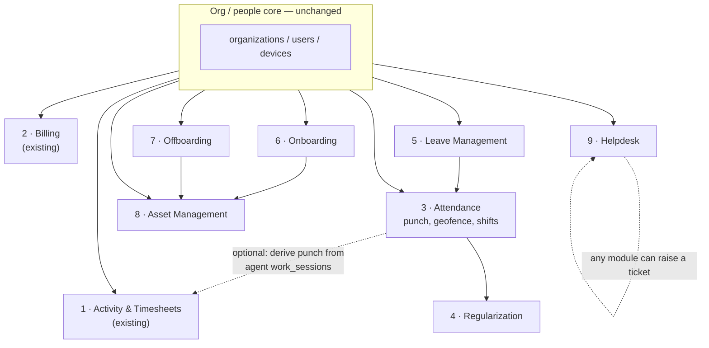

# hrdesktimesol → Full HRMS — Expansion Spec

## Purpose of this document

This is a build spec for **Claude Code**, not a user-facing doc. It extends the
existing `hrdesktimesol` system (desktop-activity tracking + timesheets +
billing) into a full HRMS — attendance with geo-location, regularization,
leave management, onboarding/offboarding, asset management, and an HR helpdesk
— in the shape of GreytHR/Keka-style products, **without breaking anything that
already works.**

Read `ARCHITECTURE.md` first. Every convention documented there is a
constraint on this work, not a suggestion:

- Multi-tenancy resolved by `Host` / `X-Org-Slug` **before** auth, everything
  filtered by `org_id`, double-checked in `get_current_user`.
- Three credential types (`user`, `platform`, `device`), `typ` claim checked
  on every path.
- Schema owned by Alembic — no `create_all`, one migration per change,
  reversible where realistic.
- Handlers thin, logic in `services/`. One new domain = one new service
  module + one new router, following the existing 19-service / 10-router
  pattern.
- Money in paise, integers, never floats.
- Reports: one shape (columns + rows), one CSV writer, `type` on each column
  decides formatting once.
- Alerts: `dispatch()` is the one door every notification goes through;
  events fire once, conditions are re-evaluated and de-duplicated.
- Jobs run in the scheduler loop (`app.scheduler`), not APScheduler-in-uvicorn,
  not Celery, unless a genuinely new trigger shape justifies it.
- Console: tenant console vs platform console split stays exactly as it is;
  new tenant pages are new entries in the existing nav + route table, not a
  parallel app.

**Do not touch:** the agent, the activity/timesheet/billing pipeline, the
naming/isolation setup in §15 of `ARCHITECTURE.md`, or anything under
`deploy/` (that directory is intentionally frozen — see Open Items §19).
New env vars are additive only; nothing existing changes meaning.

---

## 1. The full module inventory — existing + new

This is not "existing system, plus a bolted-on HRMS." The activity-monitoring
and timesheet system you already have **is one of the HRMS modules** — the
one that happens to already be built. Everything below is one product, one
module list, one console.

| # | Module | Status | Core tables |
|---|---|---|---|
| 1 | **Activity & Timesheet Monitoring** | existing | `activity_segments`, `work_sessions`, `time_entries`, `timesheet_approvals` |
| 2 | **Billing & Subscriptions** | existing | `subscriptions`, `payments`, `plan_records` |
| 3 | **Attendance** (punch, geofence, shifts) | new | `attendance_records`, `shifts`, `office_locations` |
| 4 | **Regularization** | new | `regularization_requests` |
| 5 | **Leave Management** | new | `leave_types`, `leave_balances`, `leave_applications`, `holidays` |
| 6 | **Onboarding** | new | `onboarding_templates`, `onboarding_instances`, `onboarding_tasks` |
| 7 | **Offboarding** | new | `offboarding_requests`, `offboarding_tasks`, `offboarding_fnf` |
| 8 | **Asset Management** | new | `assets`, `asset_assignments` |
| 9 | **Helpdesk** | new | `helpdesk_tickets`, `helpdesk_comments` |

Everything new hangs off the existing `organizations` / `users` /
`devices` tables. No new tenancy concept, no new credential type. The
practical effect of treating module 1 as a peer, not a foundation, is that
every place this doc talks about "the console," "the dashboards," or "the
report catalogue" below, it means all nine modules together — see §9.3 and
§10 for where that actually shows up.

### 1.1 Where module 1 (Activity & Timesheets) plugs into the new modules

- **Attendance (§2)**: for desk employees who already run the agent,
  `work_sessions.started_at`/`ended_at` can populate
  `attendance_records.check_in_at`/`check_out_at` with `check_in_source =
  'agent_session'` — no separate punch needed for that employee. Field/office
  employees without the agent punch manually. Both write to the same table;
  neither is a special case in the schema, only in which service writes the
  row.
- **Timesheets vs Leave**: a day marked `on_leave` by the leave module should
  suppress the "missing timesheet" nag from the existing timesheet-reminder
  alert — one more condition on an alert that already exists, not a new
  alert.
- **Reports**: see the naming conflict called out in §10 — the existing
  report catalogue already has a report literally named "Attendance," built
  from device activity. That name needs to be resolved before the new
  Attendance module ships its own report of the same name.

---

## 2. Attendance & geo-location

### 2.1 The core idea

An employee is either a **desk employee** (already has the agent installed —
`work_sessions` already records start/end) or a **field/office employee**
(punches in/out via the web console or a lightweight mobile-friendly PWA
punch screen, using the browser Geolocation API).

Both produce one thing: a row in `attendance_records`. The agent path is
optional and additive — attendance must work fully for a tenant with zero
agents installed.

### 2.2 Geofencing

- `office_locations` table: `org_id`, `name`, `lat`, `lng`, `radius_m`
  (default 200 m), `is_active`.
- On punch, the client sends `lat`/`lng` (or nothing, if geolocation was
  denied). The server computes Haversine distance to every active location
  for that org and accepts if within `radius_m` of **any** of them —
  multi-office orgs are normal, not an edge case.
- Punches outside every geofence are **not rejected** — they're accepted and
  flagged `is_geo_verified = false`, with `distance_from_nearest_office_m`
  stored. Hard-blocking punches breaks the product the first time someone's
  GPS drifts 50 m indoors; flag it, let a manager see it, let regularization
  fix it. This mirrors the existing philosophy in `ARCHITECTURE.md` §3 rule
  3 ("the server acknowledges, not rejects, whenever it reasonably can").
- IP address is always logged as a secondary signal, never a blocking one.
- A per-org policy flag `geofence_enforcement`: `off` / `flag_only` /
  `required`. Default `flag_only`. `required` is the only mode that actually
  blocks a punch — and even then it must return a clear, agent-style typed
  error the frontend can render, not a raw 4xx.

### 2.3 Shifts

- `shifts`: `org_id`, `name`, `start_time`, `end_time`, `grace_minutes`,
  `half_day_threshold_hours`, `is_night_shift`.
- `shift_assignments`: `user_id`, `shift_id`, `effective_from`,
  `effective_to` (nullable = current). History-preserving, like
  `WorkSchedule` already is for timesheets — don't invent a second pattern,
  reuse the effective-dated-row idiom that's already in the codebase.
- Late/early/absent/half-day computed at read time from
  `attendance_records` + the shift in force that day, never stored as a
  derived flag that can go stale.

### 2.4 `attendance_records` — the central new table

| Column | Notes |
|---|---|
| `org_id`, `user_id` | tenancy + owner |
| `date` | the attendance day (org timezone, not UTC midnight) |
| `check_in_at`, `check_out_at` | nullable independently — a missed punch is a real, visible state, not an error |
| `check_in_lat/lng`, `check_out_lat/lng` | nullable |
| `is_geo_verified_in`, `is_geo_verified_out` | bool |
| `check_in_source`, `check_out_source` | `web` / `mobile_web` / `agent_session` / `regularized` |
| `status` | `present` / `absent` / `half_day` / `on_leave` / `holiday` / `weekly_off` — computed nightly by a job, not live, so reports are cheap |
| `worked_minutes` | computed from in/out, capped at a sane max |
| `regularization_id` | set if this row exists/was edited via a regularization request |

One row per `(org_id, user_id, date)`, unique constraint — this is the same
dedup discipline as `client_uid` on `activity_segments`.

### 2.5 Regularization

An employee cannot edit `attendance_records` directly — same rule as
timesheets, where a human decision can't be silently overwritten
(`ARCHITECTURE.md` §5, `attribution` service). Instead:

- `regularization_requests`: `user_id`, `date`, `requested_check_in`,
  `requested_check_out`, `reason`, `status` (`pending`/`approved`/`rejected`),
  `reviewed_by`, `reviewed_at`, `review_note`.
- Approval writes to `attendance_records` and sets `check_in_source =
  'regularized'`; rejection leaves the original row untouched.
- Manager sees requests for their **reporting subtree** — reuse
  `hierarchy.py` exactly as timesheet approval already does. Do not
  reimplement subtree logic a second time.
- Alert: `regularization_submitted` (to manager), `regularization_decided`
  (to employee, **cannot be switched off** — same logic as
  `timesheet_decided`: a decision about someone's attendance record isn't
  marketing).

---

## 3. Leave management

### 3.1 Data model

| Table | Notes |
|---|---|
| `leave_types` | `org_id`, `name`, `is_paid`, `accrual_type` (`monthly`/`yearly`/`none`), `accrual_rate`, `max_balance`, `carry_forward_limit`, `requires_approval`, `min_notice_days` |
| `leave_balances` | `user_id`, `leave_type_id`, `year`, `opening`, `accrued`, `used`, `adjusted` — **never store a single running number**; store the components and sum at read time, so a manual correction is visible and auditable, not a silent overwrite |
| `leave_applications` | `user_id`, `leave_type_id`, `start_date`, `end_date`, `is_half_day`, `reason`, `status`, `applied_at`, `reviewed_by`, `reviewed_at` |
| `holidays` | `org_id`, `date`, `name`, `is_optional` — optional holidays are a GreytHR staple: a fixed list the employee opts into a subset of |
| `comp_off_credits` | `user_id`, `earned_date`, `reason`, `expires_at`, `used_in_application_id` |

### 3.2 Rules that matter (write these into the service, not the frontend)

- Applying for leave that overlaps an existing approved leave or an
  `attendance_records.status = present` day is a validation error, not a
  silent overwrite.
- Balance accrual runs as a scheduler job (`leave_accrual`, monthly, similar
  cadence to `retention`) — never computed ad hoc per request, or two
  concurrent requests can double-spend a balance. Approval is the atomic
  operation that debits `leave_balances.used`; a `SELECT ... FOR UPDATE` or
  equivalent row lock on the balance row is required here — this is the one
  place in the whole HRMS addition where a race condition has a direct
  financial-adjacent consequence (unpaid-leave miscalculation).
- Leave status on `attendance_records.status = on_leave` is written by the
  leave-approval flow, and holiday status by a small daily job that stamps
  `holiday` for every org holiday — same "compute once, read cheap" pattern
  as attendance status itself.
- Alerts: `leave_applied` (manager), `leave_decided` (employee, **cannot be
  switched off**), `leave_balance_low` (employee, optional, end of policy
  year).

---

## 4. Onboarding & offboarding

### 4.1 Onboarding

- `onboarding_templates`: `org_id`, `name`, `department_id` (nullable = all
  departments) — an admin builds a checklist once per role/department.
- `onboarding_template_tasks`: `template_id`, `title`, `category`
  (`documentation`/`it_setup`/`training`/`compliance`/`other`), `owner_role`
  (`hr`/`manager`/`it`/`employee`), `due_offset_days` (relative to joining
  date), `order`.
- `onboarding_instances`: created when a user is added with a future or
  today's joining date; one row per new hire, linked to a template.
- `onboarding_tasks`: instantiated copies of the template tasks, each with
  its own `status` (`pending`/`in_progress`/`done`/`skipped`),
  `completed_by`, `completed_at`.
- Pre-boarding: an onboarding instance can exist for a `user` row created in
  `status = pending_setup` state (mirrors the org-level `pending_setup`
  status already in `organizations` — reuse the same enum name/pattern) with
  no login yet, so HR can start the checklist before day one.
- Document collection: reuse `services/storage.py` — one more
  `storage_key`-based table (`onboarding_documents`: `instance_id`, `doc_type`,
  `storage_key`, `uploaded_by`, `verified_by`), not a new storage backend.

### 4.2 Offboarding

- `offboarding_requests`: `user_id`, `initiated_by`, `reason`
  (`resignation`/`termination`/`end_of_contract`), `notice_date`,
  `last_working_day`, `status`.
- `offboarding_tasks`: same shape as onboarding tasks, template-driven
  clearance checklist (`it_asset_return`, `knowledge_transfer`,
  `hr_clearance`, `finance_clearance`).
- Full-and-final settlement is **out of scope as a computed feature** — this
  needs payroll, which doesn't exist yet. Build `offboarding_fnf` as a
  manually-entered stub table (`gross_dues`, `deductions`, `net_payable`,
  `status`) an HR admin fills in and marks paid, so the workflow is complete
  even though the number isn't computed. Note this explicitly as a known gap
  in the module's own README, the way Open Items §19 does for this repo.
- On offboarding completion: user's devices are revoked (reuse the existing
  `DeviceRevoked` flow from the agent, don't build a second revoke path),
  `users.status` moves to `inactive`, manager and IT get a notification.

---

## 5. Asset management

- `assets`: `org_id`, `asset_tag` (unique per org), `category`
  (`laptop`/`monitor`/`sim`/`id_card`/`other`), `serial_number`, `purchase_date`,
  `status` (`available`/`assigned`/`under_repair`/`retired`).
- `asset_assignments`: `asset_id`, `user_id`, `assigned_at`,
  `returned_at` (nullable = currently held), `assigned_condition_note`,
  `returned_condition_note`.
- One asset can only have one open (`returned_at IS NULL`) assignment —
  enforce with a partial unique index, same idea as the device-token
  uniqueness constraint already in the schema.
- Hooked into onboarding (assign during the `it_setup` task category) and
  offboarding (return during `it_asset_return`), but usable standalone from
  an Assets page too — don't make it onboarding-only.

---

## 6. Helpdesk / HR support

- `helpdesk_categories`: `org_id`, `name`, `default_assignee_role`.
- `helpdesk_tickets`: `org_id`, `raised_by`, `category_id`, `subject`,
  `description`, `status` (`open`/`in_progress`/`resolved`/`closed`),
  `priority`, `assigned_to`, `created_at`, `resolved_at`.
- `helpdesk_comments`: `ticket_id`, `author_id`, `body`, `created_at`,
  `is_internal` (HR-only note vs visible to the employee).
- Any module can offer a "raise a ticket" affordance (e.g. a rejected
  regularization can link to "dispute this"), but helpdesk itself has no
  dependency on other modules — build it self-contained first.
- Alert: `ticket_assigned`, `ticket_resolved` — both optional, both go
  through the same `dispatch()` door as everything else.

---

## 7. API surface — new routers

Follow the existing router table shape exactly (prefix, auth, purpose).

| Router | Prefix | Auth | Purpose |
|---|---|---|---|
| `attendance` | `/api/v1/attendance` | user JWT + device token (punch endpoints) | punch in/out, own history, team view, geofence config |
| `regularization` | `/api/v1/regularization` | user JWT | submit, list own, list-for-review, approve/reject |
| `leave` | `/api/v1/leave` | user JWT | types, balances, apply, list-for-review, approve/reject, holidays |
| `onboarding` | `/api/v1/onboarding` | user JWT | templates, instances, tasks, documents |
| `offboarding` | `/api/v1/offboarding` | user JWT | requests, tasks, fnf stub |
| `assets` | `/api/v1/assets` | user JWT | register, assign, return, history |
| `helpdesk` | `/api/v1/helpdesk` | user JWT | categories, tickets, comments |

Punch endpoints (`POST /attendance/punch/in`, `/punch/out`) accept device
token **or** user JWT — a desk employee's agent could eventually call these
directly, a phone/browser punch uses the user JWT. Don't hard-code one auth
path; use the same dependency-composition style `deps.py` already has for
"either of these credential types."

---

## 8. Services — new modules, same thin-handler discipline

| Service | Owns |
|---|---|
| `attendance.py` | punch validation, geofence math, daily status computation |
| `regularization.py` | request lifecycle, writes to `attendance_records` on approval only |
| `leave.py` | balance math, accrual job body, application lifecycle, holiday stamping |
| `onboarding.py` | template instantiation, task lifecycle, pre-boarding user creation |
| `offboarding.py` | request lifecycle, device revocation trigger, task lifecycle |
| `assets.py` | assignment lifecycle, single-open-assignment enforcement |
| `helpdesk.py` | ticket lifecycle, assignment defaulting from category |
| `geofence.py` | pure Haversine + radius check, unit-testable with no DB dependency — keep this one function-only, it will get the most edge-case testing |

Scheduler additions to `app/scheduler.py`:

| Job | Every | Notes |
|---|---|---|
| `attendance_status` | nightly (e.g. 00:30 org-local — see note below) | stamps `present`/`absent`/`half_day`/`weekly_off`/`holiday` for the prior day |
| `leave_accrual` | monthly, 1st | credits `leave_balances.accrued` per policy |
| `comp_off_expiry` | daily | expires unused comp-offs past `expires_at` |

Org-local midnight is a real design decision the current jobs runner doesn't
have to make (alerts/retention are timezone-agnostic). Two acceptable
approaches — pick one and document it in the job's own docstring rather than
leaving it implicit: (a) run hourly and only act on orgs whose local time is
currently in the target window, or (b) run once at a fixed UTC time and
accept that attendance finalizes at a slightly different local hour per org.
Given `organizations.timezone` already exists in the schema, (a) is more
correct and not meaningfully more code.

---

## 9. Roles, permissions, dashboards

### 9.1 New permission flags (extend the existing per-employee flag set)

`can_approve_leave`, `can_approve_regularization`, `can_manage_assets`,
`can_manage_onboarding`, `can_manage_helpdesk` — same shape as
`can_view_screenshots` / `can_approve_timesheets` already in `users`.
No new role tier is needed; `owner > admin > manager > employee` stays as-is,
these are additional per-employee flags layered on top, exactly like the
existing ones.

### 9.2 Tenant console — new pages

| Page | Who | Notes |
|---|---|---|
| My Attendance | employee | punch button (geolocation prompt), calendar view, regularization request form |
| Team Attendance | manager | subtree view, regularization approvals |
| Attendance Settings | admin | shifts, office locations/geofence, enforcement mode |
| My Leave | employee | balances, apply, history |
| Team Leave | manager | approvals |
| Leave Settings | admin | leave types, holiday calendar |
| Onboarding | HR/admin | pipeline view of in-progress hires, per-hire checklist |
| Offboarding | HR/admin | active exits, clearance checklist |
| Assets | admin (+ "My Assets" for employee, read-only) | register, assign/return |
| Helpdesk | everyone | raise/track tickets; admin/HR gets the queue view |

These are additive rows in the existing tenant nav + route table in
`ARCHITECTURE.md` §6 — same shell, same `hrdesktimesol.token` auth, same
`X-Org-Slug` client convention. Do not build a second console shell.

### 9.3 Employee home dashboard (new "day one" screen)

A single landing page pulling together all nine modules, not just the new
eight: today's punch status/button, **this week's tracked time and
timesheet submission status (module 1)**, leave balance summary, pending
onboarding tasks (if any), open helpdesk tickets, next holiday. This is the
one genuinely new UI surface, not a bag of existing pages — worth its own
component, built last, after every module underneath it has a real API to
call.

### 9.4 Manager dashboard additions

Approvals inbox that merges regularization + leave + (existing) timesheet
approvals into one queue, sorted by age, using the existing hierarchy
subtree — this is a read-side aggregation over things that already have
their own approve/reject endpoints, not a new workflow engine.

### 9.5 Platform console

Add HRMS module toggles to the plan editor (`plan_records`) — e.g. a
"Standard" plan might exclude Asset Management, "Enterprise" includes
everything. Reuse `subscriptions.py`'s existing "what is this company
allowed to do right now" role exactly as-is; add feature keys, don't add a
second entitlement system.

---

## 10. Reports engine additions

New report types, same `report_builder.py` contract (columns + rows, `type`
per column):

| Group | New reports |
|---|---|
| Attendance | Late/Early Log, Regularization Log |
| Leave | Leave Balance, Leave Applications, Holiday Utilization |
| Assets | Asset Register, Assignment History |
| Onboarding | Onboarding Status |

**Naming conflict to resolve in Phase 0, not discover in Phase 10:** the
existing report catalogue (module 1) already ships a report named
**"Attendance"**, built from device activity presence, in the Time group
alongside Time/Activity/Idle Time/Timesheet. The new Attendance module
(module 3) is punch/geofence-based ground truth and deserves that name more
than the old one does. Do not ship two reports called "Attendance." Options,
pick one explicitly rather than letting it drift:
- Rename the existing report to **"Device Activity Presence"** and give the
  new punch-based report the "Attendance" name, or
- Merge them into one "Attendance Summary" report whose columns show both
  the punch-based status and the device-activity signal side by side, which
  is arguably more useful to an admin trying to spot proxy-attendance
  (punched in, no device activity all day) — this is the better long-term
  answer but is more work; fine to defer to Phase 10 as a named follow-up
  rather than block Phase 1 on it.

Thirteen existing report types becomes ~21 (after resolving the one
conflict above, not ~22). Nothing about the endpoint shape changes — `GET
/reports/catalogue`, `GET /reports/{key}`, `GET /reports/{key}/export.csv`
grow their catalogue, and that's the whole change at the router level.

---

## 11. Configuration additions

Additive only — append to `core/config.py`, do not rename or repurpose any
existing variable.

| Variable | Default | Purpose |
|---|---|---|
| `DEFAULT_GEOFENCE_RADIUS_M` | `200` | fallback when an office location doesn't override it |
| `GEOFENCE_ENFORCEMENT_DEFAULT` | `flag_only` | org default until admin changes it |
| `ATTENDANCE_STATUS_JOB_HOUR_LOCAL` | `0` | local hour the nightly stamp job targets |
| `COMP_OFF_DEFAULT_EXPIRY_DAYS` | `90` | |
| `ONBOARDING_DEFAULT_LOOKAHEAD_DAYS` | `30` | how far ahead "upcoming hires" surfaces on the HR dashboard |

---

## 12. Migration & compatibility checklist

Before writing the first new migration:

- [ ] Every new table has `org_id` and is covered by the same
      `test_tenant_isolation.py`-style guard.
- [ ] No existing table's columns are renamed or repurposed; only additive
      columns (e.g. nothing added to `users` breaks existing serializers —
      check `schemas/` for `orm_mode`/`from_attributes` classes that would
      need the new fields added explicitly).
- [ ] Each new migration is one logical change, matching the existing "12
      migrations" granularity, not one giant migration for the whole HRMS
      layer.
- [ ] `alembic upgrade head` still runs to completion against a copy of a
      real seeded dev DB before merging each phase.
- [ ] `app.seed` gets HRMS demo data (a few shifts, a leave policy, a couple
      of pending onboarding instances) so a fresh `docker compose up` shows a
      populated system, matching the existing demo-data philosophy.

---

## 13. Build phases — checkpoints for Claude Code

Work through these **in order**, one phase = one reviewable unit. Each phase
ends with its own migration(s), its own tests, and a working slice of UI —
never leave a phase half-wired between backend and frontend.

### Phase 0 — Schema & contracts (no UI)
- Write all new SQLAlchemy models (§2–§6) and their Alembic migrations.
- Write Pydantic schemas for every new table.
- **Done when:** `alembic upgrade head` succeeds on a fresh DB, `app.seed`
  populates demo rows for every new table, no router/service code yet.

### Phase 1 — Attendance core
- `geofence.py`, `attendance.py` service, `attendance` router (punch in/out,
  own history), nightly `attendance_status` job.
- Tests: geofence math (in/out of radius, multiple offices), duplicate-punch
  handling, status computation for present/absent/half-day.
- **Done when:** a seeded employee can punch in/out via `curl`/Swagger and
  see a correct `attendance_records` row with correct geo-verification flag.

### Phase 2 — Regularization
- `regularization.py` service + router, manager approval using existing
  `hierarchy.py`, `regularization_decided` alert (non-optional) wired
  through `dispatch()`.
- **Done when:** a rejected/approved request correctly does/doesn't mutate
  `attendance_records`, and the employee gets exactly one email either way.

### Phase 3 — Attendance + regularization UI
- My Attendance, Team Attendance, Attendance Settings pages.
- **Done when:** an admin can create an office location on a map-free
  lat/lng form, an employee can punch from the browser with a real
  geolocation prompt, a manager can approve a regularization from the queue.

### Phase 4 — Leave backend
- `leave.py` service, router, `leave_accrual` and `comp_off_expiry` jobs,
  row-locking on balance debit.
- Tests: double-approval race on the same balance is provably impossible
  (concurrent-request test, not just a unit test of the lock code path).
- **Done when:** applying, approving, and rejecting leave correctly updates
  balances and `attendance_records.status`.

### Phase 5 — Leave UI
- My Leave, Team Leave, Leave Settings (types + holiday calendar).
- **Done when:** an admin can define a leave type and a holiday list, an
  employee sees a live balance, applies, and sees the decision.

### Phase 6 — Onboarding
- Templates, instances, tasks, document upload (reusing `storage.py`),
  pre-boarding user creation.
- UI: HR pipeline view + per-hire checklist.
- **Done when:** creating a new hire with a future joining date auto-spawns
  an onboarding instance from the right template and both HR and the new
  hire (once they have login access) can check items off.

### Phase 7 — Offboarding
- Requests, tasks, device revocation trigger reusing the existing
  `DeviceRevoked` path, F&F stub.
- **Done when:** completing offboarding correctly deactivates the user and
  revokes their device(s), and the F&F stub is a real (if manually entered)
  row an admin can mark paid.

### Phase 8 — Assets
- Register, assignment lifecycle, single-open-assignment constraint, hook
  into onboarding/offboarding task categories.
- **Done when:** an asset can't be double-assigned, and asset return is
  triggerable both from the Assets page and from an offboarding task.

### Phase 9 — Helpdesk
- Categories, tickets, comments, internal-note visibility split.
- **Done when:** an employee can raise a ticket, HR can respond with an
  internal note the employee never sees, and status changes fire the two
  optional alerts.

### Phase 10 — Dashboards & reports
- Employee home dashboard, manager merged-approvals inbox, 8 new report
  types in `report_builder.py`, plan-tier feature gating in the platform
  console.
- **Done when:** every module built in Phases 1–9 has at least one report,
  and the employee/manager dashboards are the first thing each role sees
  after login.

### Phase 11 — Hardening
- `test_tenant_isolation.py` extended to cover every new table.
- Load a full demo tenant through `app.seed` and manually walk every new
  page as owner, admin, manager, and employee.
- Update `ARCHITECTURE.md` itself: fold this document's shipped reality back
  into the main architecture doc (new ERD entries, new router/service rows,
  new nav table rows) so it stays the single source of truth it currently
  is — don't leave this file as a permanently separate shadow doc once the
  work lands.

---

## 14. Explicit non-goals (for now)

- **Payroll / statutory compliance (PF, ESI, TDS)** — not started. F&F stub
  in offboarding is manual entry only, by design (§4.2).
- **Biometric device / third-party attendance hardware integration** — the
  schema (`check_in_source`) leaves room for it, but no integration is built
  in this pass.
- **Performance management / appraisals** — out of scope entirely.
- **Native mobile app** — geo-punch works via mobile browser Geolocation
  API; a dedicated app is a separate project.

Naming these now so Phase 10/11 doesn't quietly balloon into building them.
